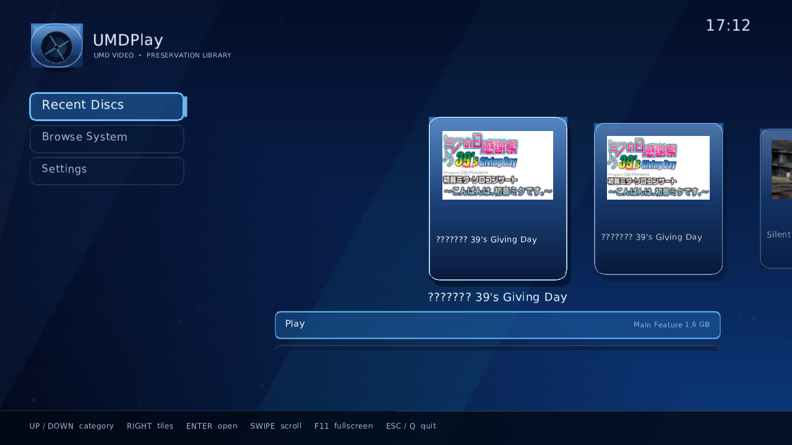
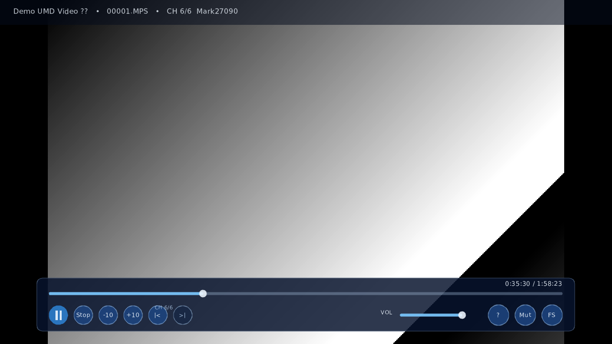
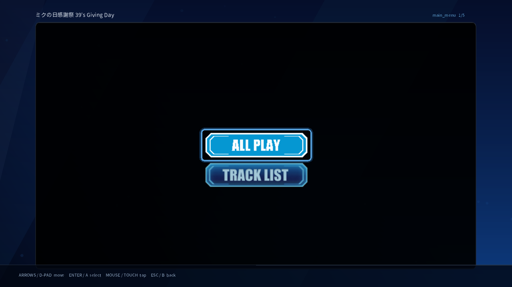
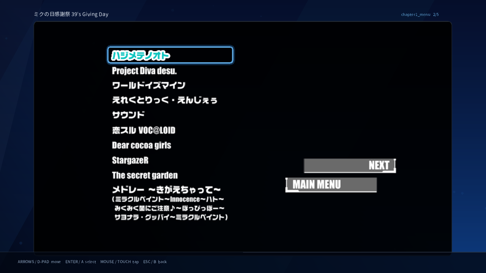

<p align="center">
  
</p>

# UMDPlay &nbsp;·&nbsp; UMD Video Preservation Engine

**Play and preserve Sony UMD Video discs straight from `.iso` or `.chd` — no
firmware, no emulator, no extraction.**

[](https://github.com/M5Devs/UMDPlay/actions/workflows/ci.yml)
[](LICENSE)


**Pure C++17 · FFmpeg + SDL2 · zero PSP firmware required**

---

## 📸 Screenshots

| Windows Media Center Hub | In-player OSD & Settings |
|:---:|:---:|
|  |  |
| Cover-art carousel, category strips, per-disc actions | Glossy auto-hiding transport bar + live Settings overlay |

| Native `.RCO` Disc Menu — main | Native `.RCO` Disc Menu — chapters |
|:---:|:---:|
|  |  |
| The disc's own `main_menu` page, driven by its VSMX script | Its `chapter1_menu` page — buttons fire the disc's `onPush` handlers |

> All four shots are rendered headlessly (`SDL_VIDEODRIVER=dummy`) from a real
> Region-2 UMD-Video disc (*Miku no Hi 39's Giving Day*). No copyrighted media
> is committed — the PNGs are UI chrome only.

---

## 🚀 What is UMDPlay?

PlayStation Portable *game* emulation is essentially solved, but **UMD Video**
discs — PSP movies, concerts and interactive comics — are still orphaned:
emulators boot the game, and generic media players choke on the proprietary
Sony packaging.

**UMDPlay** is the missing playback layer. It opens a UMD `.iso`/`.chd`
directly, parses the disc's real filesystem, demuxes the MPEG-PS `.MPS`
streams in memory with a **native, libavformat-free `PsmfDemuxer`**, and decodes
both the **H.264** video and the **ATRAC3+** audio — then presents them in a
couch-ready Windows Media Center shell, complete with the disc's **own
interactive menus**.

The long-term goal is a stable, low-overhead playback core that drops straight
into PSP emulators such as **PPSSPP** (GPLv2 was chosen for exactly this
license compatibility).

### Disc families supported

| Family | Root tree | Contents |
|---|---|---|
| **UMD-Video** | `UMD_VIDEO/` | `.MPS` movie/TV streams, `PLAYLIST.UMD`, `.RCO`/VSMX menus |
| **UMD-Music** (UMD-Audio) | `UMD_AUDIO/` | Audio tracks + `PLAYLIST.UMD` (`UMDA0088`) |
| **UMD-PG** | `UMD_VIDEO/` | Interactive visual novels — a UMD-Video disc under the hood |
| **CHD** | — | Any of the above, wrapped in MAME Compressed Hunks of Data |

---

## ✨ Features

**Disc & container**
- ISO 9660/UDF **dynamic tree walk** — finds `UMD_VIDEO/`/`UMD_MUSIC/` and
  `STREAM/` from the PVD, so discs with non-standard LBAs still load.
- **`.iso` and `.chd`** through one `DiscReader` abstraction (libchdr backend
  with a decompressed-hunk cache). Byte-identical playback from ISO and CHD.
- Reads **`PARAM.SFO`**, **`PLAYLIST.UMD`** (`UMDV0088`/`UMDA0088`) and
  **`CLPI0088`** clip info.

**Decoding**
- In-memory **MPEG-2 Program Stream** demuxing via a native `PsmfDemuxer` over
  `DiscReader` (no `libavformat`).
- **H.264 AVC** video, with optional **480i `yadif` deinterlacing**.
- **Sony PSMF ATRAC3+** audio reverse-engineered from **Private Stream 1
  (`0xBD`)** — class-byte-agnostic frame sync and a **measured** frame stride,
  so both 696-byte (video) and 1720-byte (music) discs decode.

**Windows Media Center 10-foot UI**
- Recent / Browse / Options strips, cover-art carousel from `ICON0.PNG`,
  per-disc actions, chapters panel and extras sub-menu.
- Full **player transport**: pause/resume, ±10 s / ±30 s and scrub seeking with
  keyframe-accurate resync, volume/mute, auto-hiding glossy OSD with `HH:MM:SS`.
- **Touch & gesture** input (swipe/drag on the OSD), keyboard and gamepad.
- **Procedural UI sound effects** — WMC navigation chimes synthesized at
  runtime (no bundled samples); toggle in Options or `--no-ui-sounds`.

**Native `.RCO` Disc Menus**
- Renders the disc's own `.RCO` pages (embedded PNG art) and runs its **VSMX**
  bytecode menu VM, so page switches, chapter lists and "play the feature"
  behave exactly as the disc authored them.

**Tooling**
- `--probe` disc structure dump, `--export-clip` headless MP4 export, and
  `--demo` / `--demo-player` synthetic-data rendering for CI screenshots.

---

## 🛠️ Tech stack

| Component | Technology | Notes |
|---|---|---|
| Language | C++17 | Modern standard, max compiler compatibility |
| Decoder | FFmpeg `libavcodec` / `libswscale` / `libswresample` | Native `PsmfDemuxer` feeds `libavcodec`; optional `libavfilter` for yadif (no `libavformat`) |
| Output & rendering | SDL2 | Software/GPU video, audio, input |
| 10-foot UI | Dear ImGui (SDL2 + SDLRenderer2) | Immediate-mode WMC shell |
| Image decode | stb_image / stb_image_write | `PARAM.SFO` art (`ICON0`/`PIC1`) + PNG screenshots |
| Disc images | ISO 9660/UDF · CHD (libchdr) | `DiscReader` backend chosen by extension |
| Build system | CMake | GCC / Clang / MSVC / MinGW |

---

## 🔧 Building from source

### Pre-built binaries

Tagged releases ship ready-to-run bundles on the
[Releases page](https://github.com/M5Devs/UMDPlay/releases):

- **Linux x86_64** — `.tar.gz`; extract and run `./umdplay.sh <disc.iso>`
  (shared libraries bundled).
- **Windows x86_64** — `.zip`; extract and run `umdplay.exe <disc.iso>`
  (MinGW runtime, SDL2 and FFmpeg DLLs bundled).
- **macOS arm64** (Apple Silicon) — `.tar.gz`; extract and run
  `./umdplay.sh <disc.iso>` (Homebrew FFmpeg/SDL2 dylibs bundled, ad-hoc signed).
- **macOS x86_64** (Intel) — `.tar.gz`; same as above for Intel Macs.

### Prerequisites (Ubuntu / Debian)

```bash
sudo apt-get update
sudo apt-get install -y cmake build-essential pkg-config \
                        libavcodec-dev libavutil-dev \
                        libswscale-dev libswresample-dev libsdl2-dev
# Optional: 480i deinterlacing (yadif)
sudo apt-get install -y libavfilter-dev
# Optional: CJK font so Japanese disc titles render
sudo apt-get install -y fonts-noto-cjk
# Optional: ffmpeg CLI, needed only for --export-clip
sudo apt-get install -y ffmpeg
```

Dear ImGui and `stb_image` are fetched/vendored automatically by CMake; libchdr
is fetched and statically linked for `.chd` support.

### Build & test

```bash
git clone https://github.com/M5Devs/UMDPlay.git
cd UMDPlay

cmake -B build -DCMAKE_BUILD_TYPE=Release
cmake --build build -j"$(nproc)"

# Play any UMD image directly
./build/bin/umdplay /path/to/movie.iso
./build/bin/umdplay /path/to/movie.chd      # CHD works identically

# Tests
cd build && ctest --output-on-failure
```

### Windows (MSYS2 / MinGW-w64)

The sources are portable to Windows; `_WIN32` branches replace the POSIX-only
file-descriptor and process-spawning calls. From an **MSYS2 MINGW64** shell:

```bash
pacman -S --needed git mingw-w64-x86_64-gcc mingw-w64-x86_64-cmake \
                       mingw-w64-x86_64-ninja mingw-w64-x86_64-pkgconf \
                       mingw-w64-x86_64-SDL2 mingw-w64-x86_64-ffmpeg
cmake -B build -G Ninja -DCMAKE_BUILD_TYPE=Release -DUMDPLAY_WERROR=ON
cmake --build build
cd build && ctest --output-on-failure
```

Run `umdplay.exe` from a MINGW64 shell (or copy the MinGW/SDL2/FFmpeg DLLs
next to it); the release `.zip` already bundles them.

### macOS (Apple Silicon + Intel)

The sources are portable to macOS (the POSIX branches compile unchanged under
Apple Clang). With [Homebrew](https://brew.sh):

```bash
brew install cmake pkg-config ffmpeg sdl2

export PKG_CONFIG_PATH="$(brew --prefix)/opt/ffmpeg/lib/pkgconfig:$(brew --prefix)/opt/sdl2/lib/pkgconfig"
cmake -B build -DCMAKE_BUILD_TYPE=Release -DUMDPLAY_WERROR=ON
cmake --build build -j"$(sysctl -n hw.ncpu)"
cd build && ctest --output-on-failure
```

The release `.tar.gz` bundles the Homebrew `.dylibs` (relinked with
`dylibbundler`), so no Homebrew install is needed at runtime. It is ad-hoc
signed but not notarized: on first launch, right-click the app and choose
**Open**, or run `xattr -dr com.apple.quarantine umdplay`.

### Strict / sanitizer builds (what CI enforces)

```bash
# Zero-warning build (the CI bar)
cmake -B build-werror -DUMDPLAY_WERROR=ON && cmake --build build-werror -j"$(nproc)"

# Address + Undefined + Leak sanitizers (suppressions in tests/lsan.supp)
cmake -B build-san -DUMDPLAY_SANITIZE=ON && cmake --build build-san -j"$(nproc)"
LSAN_OPTIONS=suppressions="$PWD/tests/lsan.supp" \
    ctest --test-dir build-san --output-on-failure
```

### Headless (CI / Docker)

```bash
# Render a frame off-screen and exit
SDL_AUDIODRIVER=dummy xvfb-run -a -s "-screen 0 1280x720x24" \
    ./build/bin/umdplay movie.iso --screenshot shot.png
```

---

## 🎮 Command-line options

```text
Usage: umdplay [path_to_umd.iso|.chd] [options]
  --play                 start the main feature immediately
  --export-clip <mp4>    decode a clip to MP4 (H.264/AAC) and exit
  --clip-seconds <n>     clip length in seconds (default 12)
  --screenshot <png>     render a frame, write a PNG, then exit
  --start <seconds>      start at this offset
  --fullscreen           start in fullscreen (F11 / Alt+Enter toggles)
  --strip <name>         start on a hub strip: recent|browse|settings
  --open-settings        open the player Settings overlay
  --open-menu            open the interactive .RCO Disc Menu
  --menu-page <name>     start the Disc Menu on a named page
  --aspect <mode>        zoom mode: auto|16:9|4:3|fill
  --no-ui-sounds         start with the WMC UI chimes muted
  --probe                print stream/metadata info and exit
  --verbose              with --probe: disassemble the menu VSMX script
  --demo                 render the hub with synthetic data (no disc image)
  --demo-player          render the player OSD over synthetic video (no disc)
```

**Inspect a disc**

```bash
./build/bin/umdplay movie.iso --probe            # filesystem, streams, playlist, RCO
./build/bin/umdplay movie.iso --probe --verbose  # + VSMX menu disassembly
```

**Export a clip (headless A/V decode proof)**

```bash
# ~12 s from the middle of the movie, muxed to a playable MP4
./build/bin/umdplay movie.iso --export-clip test_clip.mp4 --start 3552 --clip-seconds 12
ffprobe test_clip.mp4
```

---

## 🪟 The Windows Media Center UI

The default front-end is a couch-friendly WMC shell. It launches in a clean
resizable 1280×720 window; press **F11** / **Alt+Enter** to toggle fullscreen.

Three horizontal strips, switched with **LEFT / RIGHT**:

| Strip | Contents |
|---|---|
| **Recent Discs** | Every disc you have opened, persisted to `~/.config/umdplay/recent.txt` (override with `$UMDPLAY_CONFIG_DIR`), shown as cover-art cards from `ICON0.PNG`. |
| **Browse System** | A built-in `std::filesystem` browser; filters to `*.iso` / `*.chd` and opens any UMD image. |
| **Options** | Display Mode, Audio Volume, Mute and the **UI Sounds** toggle. |

Per-disc actions replace the raw `.MPS` list with clean choices — **Play** (the
main feature), **Extras** (bonus streams, when present) and **Options**.

### Controls

```text
LEFT / RIGHT     switch strip (tabs) / move cards / adjust a setting
UP / DOWN        move between tabs, cards and action rows
ENTER / SPACE    open disc, enter folder, activate action
BACKSPACE        Browse: up one directory
F11 / Alt+Enter  toggle fullscreen
ESC              back one level (Hub) / return to Hub (player)
Q                quit
```

### Player transport

The glossy transport bar fades in on any input and auto-hides after ~3 s of
inactivity — but never while paused or hovered.

```text
SPACE                 play / pause (video clock + SDL audio pause together)
LEFT / RIGHT          seek -10 s / +10 s
SHIFT+LEFT/RIGHT      seek -30 s / +30 s
drag the timeline     scrub to any position
UP / DOWN             volume -5% / +5%
M                     mute / unmute
T                     open the Disc Menu (when the disc ships one)
PageUp / [            previous chapter      PageDown / ]   next chapter
F11 / Alt+Enter       toggle fullscreen
ESC / BACKSPACE       stop and return to the Hub
```

Chapters come from `PLAYLIST.UMD`: the hub's **Chapters** action opens a marker
list, and the transport carries `|<` / `>|` buttons plus a `CH n/N` readout.

### Disc Menu (native `.RCO` pages)

When a disc ships an interactive menu (`RESOURCE/*.RCO`), the OSD grows a
**Menu** button and `T` opens the **Disc Menu**: the disc's own `.RCO` pages,
drawn from embedded PNG art, navigated with the arrows / D-pad (mouse hover and
touch taps focus directly). Each button fires the page's own VSMX `onPush`
handler, so page switches (`pageID`), chapter lists and "play the feature" all
behave as authored. The focused button shows its `_sel` artwork and a glowing
ring; `ESC`/`B` steps back (or leaves at the top level), `ENTER`/`A` activates.

---

## 🗂️ Project layout

```text
include/ · src/     C++17 modules — iso_reader, disc_reader, psmf_demuxer,
                    decoder, param_sfo, playlist_parser, rco_parser, vsmx_vm,
                    rco_menu, wmc_ui, ui_sfx, clip_export, ui_manager
tests/              ctest suites (10) + fixtures + lsan.supp
docs/               ARCHITECTURE.md · TESTED_DISCS.md · CHD_GUIDE.md
screenshots/        README showcase images (headless renders)
third_party/        vendored stb_image
```

---

## 📚 Documentation

| Document | Contents |
|---|---|
| [`docs/ARCHITECTURE.md`](docs/ARCHITECTURE.md) | Reverse-engineered UMD internals — UDF layout, `PARAM.SFO`, `PLAYLIST.UMD` (`UMDV0088`), `CLPI0088`, `.RCO` (`\0PRF`) + VSMX bytecode, Sony PSMF ATRAC3+ (`0xBD`) framing |
| [`docs/TESTED_DISCS.md`](docs/TESTED_DISCS.md) | Every real disc tested, what it exercised, and the bugs each one exposed (compatibility matrix) |
| [`docs/CHD_GUIDE.md`](docs/CHD_GUIDE.md) | **Safe** UMD ISO → CHD compression — sector specs, the exact `chdman createdvd` command, verifying and restoring |
| [`AGENTS.md`](AGENTS.md) | Module map, build/test/CI commands and the technical gotchas for anyone (human or AI) working on the code |

### Compressing a UMD ISO to CHD (quick version)

A UMD is a **2048-byte-sector, single-track, DVD-style** disc, so it must be
compressed in **DVD mode**. Use `createdvd` — **never** `createcd`:

```bash
chdman createdvd -i movie.iso -o movie.chd    # ✅ correct for UMD
chdman verify   -i movie.chd                  # confirm the copy is intact
chdman extractdvd -i movie.chd -o movie.iso   # lossless restore, byte-identical

# ❌ chdman createcd -i movie.iso -o movie.chd  (2352-byte CD mode — breaks the image)
```

If `chdman info -i movie.chd` reports `Unit Size: 2048` you did it right.
Full details in the [CHD Compression Guide](docs/CHD_GUIDE.md).

---

## 🗺️ Roadmap

- [x] **Phase 1 — ISO & UDF Parser**: navigate `UMD_VIDEO/STREAM/`, resolve LBAs dynamically.
- [x] **Phase 2 — Streaming & Decoding**: native in-memory `PsmfDemuxer`, H.264 AVC, PSMF ATRAC3+ reverse-engineering.
- [x] **Phase 3 — Standalone Player + WMC UI**: synced A/V playback, WMC 10-foot shell, headless clip export.
- [x] **Phase 4 — Interactive Menus & Chapters**: `PLAYLIST.UMD` / `CLPI0088`, real chapters, `.RCO` object tree + VSMX menu VM.
- [x] **Phase 4.5 — Unified `DiscReader`**: ISO + CHD via libchdr.
- [x] **Phase 6 (Step 1) — FFmpeg Independence**: native `PsmfDemuxer` replaces `libavformat` demuxing (ISO + CHD).
- [ ] **Phase 5 — PPSSPP integration**: expose a clean C-style API for native upstream integration.

---

## 📜 License

Licensed under the **GNU General Public License v2.0 (GPLv2)** — chosen
specifically for **license compatibility with PPSSPP**, enabling clean upstream
integration without legal friction. See [`LICENSE`](LICENSE).

*Disclaimer: This project is strictly for digital preservation and educational
purposes. "PSP" and "UMD" are trademarks of Sony Interactive Entertainment Inc.*
