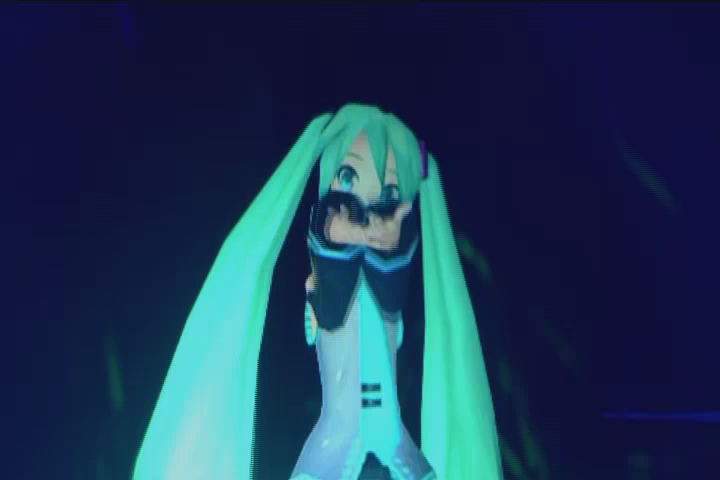
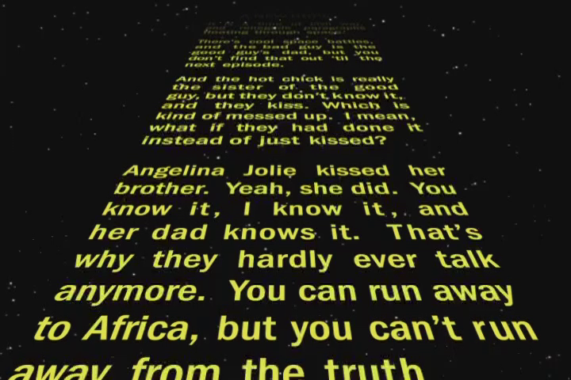

# UMDPlay (UMD Video Player)

[](https://github.com/M5Devs/UMDPlay/actions/workflows/ci.yml)


> A lightweight, cross-platform C++17 library and standalone media player designed to parse, decode, and play **UMD Video ISOs** on the fly without disk extraction — the missing link in PSP preservation.

The ultimate goal of this project is to achieve a stable, low-overhead playback layer for UMD Video content that can be seamlessly integrated into existing PSP emulators (such as **PPSSPP**) or used as an independent preservation tool.

---

## 🚀 Vision & Motivation

While PlayStation Portable (PSP) game emulation has reached near-perfection, native support for **UMD Video ISOs** remains largely unsupported across all major emulators.

UMD Video discs use a specific filesystem structure rooted in the `UMD_VIDEO/` directory, containing:
- **MPEG Program Stream (`.MPS`)** containers with **H.264 AVC or MPEG-2** video tracks
- **ATRAC3plus** audio formats packed inside proprietary Sony **Private Stream 1 (`0xBD`)**
- Interactive menu overlays built on **`.RCO` / `.VBO`** assets

**UMDPlay** bridges this gap by decoding streams directly in memory via FFmpeg `AVIOContext`, eliminating the need for multi-gigabyte disk extraction.

---

## 🛠️ Tech Stack & Dependencies

| Component | Technology | Notes |
|---|---|---|
| Language | C++17 | Modern standard, max compiler compatibility |
| Decoder | FFmpeg (libavcodec / libavformat) | In-memory stream demuxing & decoding |
| Output & Rendering | SDL2 | Software & GPU-accelerated video/audio output |
| 10-foot UI | Dear ImGui (SDL2 + SDLRenderer2) | Lightweight, immediate-mode WMC-style shell |
| Image decode | stb_image / stb_image_write | PARAM.SFO art (`ICON0`/`PIC1`) + PNG screenshots |
| Build System | CMake | Cross-platform, supports MinGW / MSVC / GCC |

---

## 🗺️ Roadmap

- [x] **Phase 1 — ISO & UDF Parser**: navigate `UMD_VIDEO/STREAM/`, dynamically resolve LBAs and file sizes from sector 28.
- [x] **Phase 2 — Streaming & Decoding**: in-memory streaming via custom `AVIOContext`, H.264 AVC video decoding, and Sony PSMF ATRAC3+ audio frame reverse-engineering.
- [x] **Phase 3 — Standalone Player + WMC UI**: synced real-time A/V playback with a Windows Media Center-inspired 10-foot UI (disc hub, cover art, transport OSD) and a headless clip-export mode.
- [ ] **Phase 4 — Menu Research**: reverse-engineer interactive menus via `.RCO` / `.VBO` overlays.
- [ ] **Phase 5 — PPSSPP Integration**: expose a clean C-style API for native upstream integration.

---

## 🎮 Command-Line Options

```text
Usage: umdplay <path_to_umd_video.iso> [options]
  --play                 start the main feature immediately
  --export-clip <mp4>    decode a clip to MP4 (H.264/AAC) and exit
  --clip-seconds <n>     clip length in seconds (default 12)
  --screenshot <png>     render a frame, write a PNG, then exit
  --start <seconds>      start at this offset
  --probe                print stream/metadata info and exit
  --demo                 render the hub with synthetic data (no ISO)
```

**Headless clip export** decodes the main `.MPS` stream and muxes H.264 video
plus AAC audio into a standard MP4 via the `ffmpeg` CLI (no extra muxing
dependency). This is handy for verifying decode on machines without a display:

```bash
# ~12 s from the middle of a movie, written as a playable MP4
./build/bin/umdplay movie.iso --export-clip test_clip.mp4 --start 3552 --clip-seconds 12
ffprobe test_clip.mp4
```

---

## 🔧 Building from Source

### Prerequisites (Ubuntu / Debian)
```bash
sudo apt-get update
sudo apt-get install -y cmake build-essential pkg-config \
                        libavformat-dev libavcodec-dev libavutil-dev \
                        libswscale-dev libswresample-dev libsdl2-dev
# Optional: CJK font so Japanese disc titles render (Noto Sans CJK)
sudo apt-get install -y fonts-noto-cjk
# Optional: ffmpeg CLI, needed only for --export-clip
sudo apt-get install -y ffmpeg
```

Dear ImGui and `stb_image` are fetched/vendored automatically by CMake.

### Build Steps
```bash
# 1. Clone the repository
git clone https://github.com/M5Devs/UMDPlay.git
cd UMDPlay

# 2. Configure & Build
cmake -B build -DCMAKE_BUILD_TYPE=Release
cmake --build build

# 3. Run directly against any UMD Video ISO
./build/bin/umdplay /path/to/movie.iso

# 4. Run the tests
cd build && ctest --output-on-failure
```

> On a headless machine (CI, Docker) render off-screen with Xvfb, e.g.
> `xvfb-run -a -s "-screen 0 1280x720x24" ./build/bin/umdplay movie.iso --screenshot shot.png`.

---

## 🖼️ Verified Decoded Frames (Proof of Concept)

| Hatsune Miku: Project DIVA (39's Giving Day) | Family Guy: Blue Harvest (Star Wars Parody) |
|:---:|:---:|
|  |  |
| *Japanese UMD Video (Concert)* | *US Commercial UMD Video (Hollywood)* |

---

## 📜 License

This project is licensed under the **GNU General Public License v2.0 (GPLv2)**.  
GPLv2 was chosen specifically to ensure **license compatibility with the PPSSPP project**, enabling clean upstream integration without legal friction.

*Disclaimer: This project is strictly for digital preservation and educational purposes. "PSP" and "UMD" are trademarks of Sony Interactive Entertainment Inc.*
