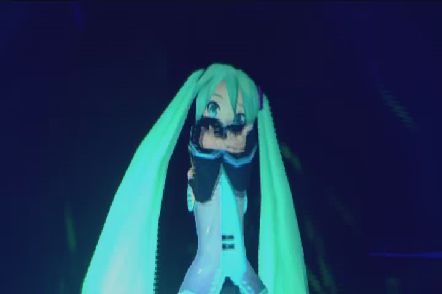
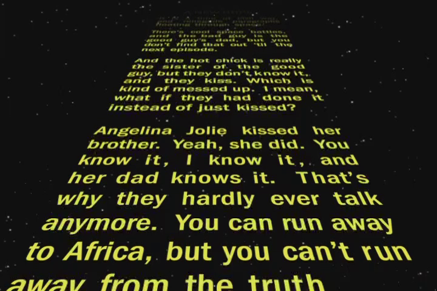

# UMDPlay (UMD Video Player)

[](https://github.com/M5Devs/UMDPlay/actions/workflows/ci.yml)


> A lightweight, cross-platform C++17 library and standalone media player designed to parse, decode, and play **UMD Video ISOs** on the fly without disk extraction — the missing link in PSP preservation.

The ultimate goal of this project is to achieve a stable, low-overhead playback layer for UMD Video content that can be seamlessly integrated into existing PSP emulators (such as **PPSSPP**) or used as an independent preservation tool.

---

## 🚀 Vision & Motivation

While PlayStation Portable (PSP) game emulation has reached near-perfection, native support for **UMD Video ISOs** remains largely unsupported across all major emulators.

UMD Video discs use a specific filesystem structure rooted in the `UMD_VIDEO/` directory, containing:
- **MPEG Program Stream (`.MPS`)** containers with **H.264 AVC or MPEG-2** video tracks
- **ATRAC3plus** audio formats packed inside proprietary Sony **Private Stream 1 (`0xBD`)**
- Interactive menu overlays built on **`.RCO` / `.VBO`** assets

**UMDPlay** bridges this gap by decoding streams directly in memory via FFmpeg `AVIOContext`, eliminating the need for multi-gigabyte disk extraction.

---

## 🛠️ Tech Stack & Dependencies

| Component | Technology | Notes |
|---|---|---|
| Language | C++17 | Modern standard, max compiler compatibility |
| Decoder | FFmpeg (libavcodec / libavformat) | In-memory stream demuxing & decoding |
| Output & Rendering | SDL2 | Software & GPU-accelerated video/audio output |
| Build System | CMake | Cross-platform, supports MinGW / MSVC / GCC |

---

## 🗺️ Roadmap

- [x] **Phase 1 — ISO & UDF Parser**: navigate `UMD_VIDEO/STREAM/`, dynamically resolve LBAs and file sizes from sector 28.
- [x] **Phase 2 — Streaming & Decoding**: in-memory streaming via custom `AVIOContext`, H.264 AVC video decoding, and Sony PSMF ATRAC3+ audio frame reverse-engineering.
- [ ] **Phase 3 — Standalone SDL2 Player**: synced real-time A/V playback window with keyboard controls (Play, Pause, Seek).
- [ ] **Phase 4 — Menu Research**: reverse-engineer interactive menus via `.RCO` / `.VBO` overlays.
- [ ] **Phase 5 — PPSSPP Integration**: expose a clean C-style API for native upstream integration.

---

## 🔧 Building from Source

### Prerequisites (Ubuntu / Debian)
```bash
sudo apt-get update
sudo apt-get install -y cmake build-essential pkg-config \
                        libavformat-dev libavcodec-dev libavutil-dev \
                        libswscale-dev libswresample-dev
```

### Build Steps
```bash
# 1. Clone the repository
git clone https://github.com/M5Devs/UMDPlay.git
cd UMDPlay

# 2. Configure & Build
cmake -B build -DCMAKE_BUILD_TYPE=Release
cmake --build build

# 3. Run directly against any UMD Video ISO
./build/bin/umdplay /path/to/movie.iso
```

---

## 🖼️ Verified Decoded Frames (Proof of Concept)

| Hatsune Miku: Project DIVA (39's Giving Day) | Family Guy: Blue Harvest (Star Wars Parody) |
|:---:|:---:|
|  |  |
| *Japanese UMD Video (Concert)* | *US Commercial UMD Video (Hollywood)* |

---

## 📜 License

This project is licensed under the **GNU General Public License v2.0 (GPLv2)**.  
GPLv2 was chosen specifically to ensure **license compatibility with the PPSSPP project**, enabling clean upstream integration without legal friction.

*Disclaimer: This project is strictly for digital preservation and educational purposes. "PSP" and "UMD" are trademarks of Sony Interactive Entertainment Inc.*
